<p align="center">
  
</p>

<h1 align="center">TokenForge</h1>

<p align="center">
  <strong>Forja una vez. Ejecuta para siempre.</strong><br>
  Convierte el trabajo repetitivo de tus agentes en handles de Python probados que cuestan ~0 tokens por ejecución.<br>
  <a href="README.md">English</a> · <a href="docs/ARCHITECTURE.md">Arquitectura (EN)</a> · <a href="CONTRIBUTING.md">Contribuir</a> · <a href="SECURITY.md">Seguridad</a>
</p>

<p align="center">
  <a href="https://github.com/fabianmelomaciel/TokenForge/releases"></a>
  <a href="https://www.python.org/downloads/"></a>
  <a href="LICENSE"></a>
  <a href="https://github.com/fabianmelomaciel/TokenForge/actions/workflows/ci.yml"></a>
  
  
</p>

Tu agente es capaz. También es desmemoriado. TokenForge le da un lugar donde guardar el trabajo que nunca debería repetir: un archivo Python pequeño, un test y una línea de memoria.

## El problema

Tu agente vuelve a derivar la misma tarea en cada sesión. La misma regex, el
mismo reformateo del JSON, los mismos cinco comandos de shell. Pagas el precio
completo en tokens por una solución que ya existía ayer.

## La solución

Un bucle, cinco pasos:

| | Paso | Qué pasa |
|---|---|---|
| 1 | **CHECK** | `forge list` o `forge search <query>` lee `.forge/memory.json`. |
| 2 | **RUN** | `forge run <name> --json '{...}'` ejecuta el handle existente. |
| 3 | **FORGE** | `forge new <name> --task "..."` escribe un archivo Python con un selftest integrado. |
| 4 | **REGISTER** | `new` registra nombre, firma de la tarea, ruta y etiquetas automáticamente. |
| 5 | **REUSE** | Ejecútalo para siempre. Edita el handle cuando cambie la tarea. |

Si una tarea es creativa, de una sola vez, ambigua o necesita secretos o estado
de red en tiempo real, no la forjes. Resuélvela directamente.

## Demo en 30 segundos

```console
$ python -m forge init
Initialized TokenForge in /home/you/demo/.forge
$ python -m forge new slugify --task "convert text to a URL slug" --tags text,url
Forged handle 'slugify'
  file:   /home/you/demo/.forge/handles/slugify.py
  task:   convert text to a URL slug
  tags:   text, url
  danger: no
$ python -m forge test slugify
{"handle": "slugify", "ok": true, "selftest": "passed"}
# ahora edita .forge/handles/slugify.py: handle() devuelve {"ok": true, "slug": slugify(text)}
$ python -m forge run slugify --json '{"text": "Hello World"}'
{"ok": true, "slug": "hello-world"}
$ python -m forge stats
TokenForge stats for /home/you/demo
  handles:              1
  total uses:           1
  tokens saved (est):   1,200

Conservative estimate: 80% of an assumed 1,500 tokens of manual work per successful run. Actual savings vary.

NAME     USES  LAST USED            TOKENS SAVED  TASK
-------  ----  -------------------  ------------  --------------------------
slugify  1     2026-01-01 12:00:00  1,200         convert text to a URL slug
```

La plantilla incluye un saludo funcional para que puedas probar el bucle antes
de editarla. Reemplaza `handle()` por tu lógica de slug, actualiza
`_selftest()` y ejecuta `forge test slugify` otra vez. Un handle es un punto de
partida, no una prueba. Hay una implementación real en
[`examples/handles/slugify.py`](examples/handles/slugify.py).

## Instalación

Python 3.8+. Sin dependencias en tiempo de ejecución.

```bash
# macOS / Linux
git clone https://github.com/fabianmelomaciel/TokenForge.git
cd TokenForge
python3 -m pip install .
forge --version
forge install --global
```

```powershell
# Windows PowerShell
git clone https://github.com/fabianmelomaciel/TokenForge.git
cd TokenForge
python -m pip install .
forge --version
forge install --global
```

`pip install .` instala el comando `forge` y el `SKILL.md` canónico; usa un
entorno virtual si tu Python del sistema está gestionado externamente. Si
`forge` no está en tu PATH, usa `python -m forge`.

### Clon manual, sin pip

`install.py` tiene que ejecutarse desde el repositorio porque importa `forge/`.
Instala la skill y los punteros de IDE, pero **no** crea un comando global
`forge`.

```bash
git clone https://github.com/fabianmelomaciel/TokenForge.git
cd TokenForge
python3 install.py --global   # Windows: python install.py --global
```

Ejecuta la CLI desde el clon, o agrega el clon a `PYTHONPATH`:

```bash
python3 -m forge --project /ruta/a/tu/proyecto init
export PYTHONPATH="/ruta/a/TokenForge:$PYTHONPATH"   # macOS / Linux
$env:PYTHONPATH = "C:\ruta\a\TokenForge"             # Windows
```

`install.py` y `forge install` solo tocan rutas conocidas de IDE, guardan una
copia en `<archivo>.tokenforge.bak` antes del primer cambio y respetan
`--dry-run`. Agrega `--force` para crear directorios de configuración faltantes,
o filtra con `--ide opencode,claude,cursor`.

## Compatibilidad

| Herramienta | Global | Proyecto |
|---|---|---|
| **opencode** | `~/.config/opencode/skills/tokenforge/SKILL.md` + `AGENTS.md` (también `%APPDATA%\opencode` en Windows) | `.opencode/skills/tokenforge/SKILL.md` + `AGENTS.md` |
| **Claude Code** | `~/.claude/skills/tokenforge/SKILL.md` + `~/.claude/CLAUDE.md` | `.claude/skills/tokenforge/SKILL.md` + `CLAUDE.md` |
| **Cursor** | `~/.cursor/rules/tokenforge.mdc` | `.cursor/rules/tokenforge.mdc` |
| **Windsurf** | `~/.codeium/windsurf/memories/global_rules.md` | `.windsurf/rules/tokenforge.md` |
| **Codex** | `~/.codex/AGENTS.md` | `AGENTS.md` |
| **Gemini CLI** | `~/.gemini/GEMINI.md` | `GEMINI.md` |
| **VS Code Copilot** | — (solo proyecto) | `.github/copilot-instructions.md` |
| **`AGENTS.md` genérico** | — | bloque en `AGENTS.md` (vía el destino opencode o codex) |

Los destinos globales se omiten si falta el directorio de configuración de la
herramienta; usa `--force` para crearlo. El destino global de Windsurf solo se
escribe si `~/.codeium/windsurf` ya existe. Los archivos compartidos se editan
en el lugar entre los marcadores `<!-- tokenforge:begin -->` y
`<!-- tokenforge:end -->`, así que `forge uninstall` elimina solo contenido de
TokenForge.

## Cómo funciona la memoria

`forge init` crea `.forge/config.json`, `.forge/memory.json` y
`.forge/handles/`. Una entrada de memoria se ve así:

```json
{
  "name": "slugify", "task": "convert text to a URL slug",
  "signature": "<sha256 en hex>",
  "path": ".forge/handles/slugify.py",
  "created": "2026-01-01T12:00:00+00:00", "last_used": null,
  "uses": 0, "tokens_saved_est": 0, "avg_tokens_manual": 1500,
  "tags": ["text", "url"], "danger": false
}
```

- **Solo metadatos.** No guarda prompts, salidas, variables de entorno ni contenido de archivos.
- **Tareas redactadas.** Los patrones comunes de claves y tokens se reemplazan antes de persistir. La redacción es una red de seguridad, no una garantía; nunca pongas secretos en `--task`.
- **Escrituras atómicas.** Archivo temporal + `os.replace`; `.forge/memory.lock` serializa a los escritores.
- **Autorreparación.** El JSON corrupto se mueve a `memory.corrupt.<stamp>.json` y se reemplaza.

## Aritmética de tokens, con honestidad

TokenForge estima de forma conservadora: `tokens_saved_est = ejecuciones_exitosas × avg_tokens_manual × 0.8`.

- `avg_tokens_manual` vale **1.500** por defecto; se ajusta por handle con `forge new ... --avg-tokens N`, o en `.forge/config.json`.
- El factor `0.8` es un descuento fijo por el costo de forjar, revisar y probar.
- Cada estimación lleva `(est)` o va seguida de la nota de estimación conservadora. Es una señal de presupuesto, no una factura; `forge stats --json` devuelve las mismas cifras.

Diez ejecuciones exitosas con el supuesto por defecto reportan **12.000 tokens
ahorrados (est.)**. Tu número real depende de lo que el agente habría hecho sin
el handle. No hay benchmark: solo aritmética que puedes auditar.

## Seguridad

TokenForge ejecuta Python generado. Trata cada handle como código de un
desconocido, porque hasta que lo leas, lo es.

- **Revisa antes de ejecutar.** `forge new` escribe un archivo; `forge run` lo ejecuta con `sys.executable` y un vector de argumentos. `shell=True` nunca se usa y no hay sandbox. Los handles heredan tu entorno y tus permisos.
- **Contención de rutas.** Los nombres se validan con `^[a-z][a-z0-9_-]{0,63}$` y las rutas resueltas deben quedar dentro de `.forge/handles/`. Se rechazan `.forge/` o `handles/` que sean symlinks.
- **Handles peligrosos y timeouts.** Los handles `--danger` requieren `--yes` cuando la sesión no es interactiva. Las ejecuciones tienen un límite de 120 segundos por defecto; cámbialo con `--timeout` o `default_timeout` en `.forge/config.json`.
- **Sin secretos en memoria.** `.forge/memory.json` guarda solo metadatos. El texto de la tarea se redacta para credenciales comunes, pero la redacción es una red de seguridad, no una garantía.

## Preguntas frecuentes

**¿Esto es solo un caché?**
No. Un caché repite una salida; TokenForge escribe y prueba código, y después lo ejecuta con entradas nuevas.

**¿Qué pasa si cambia la tarea?**
Edita `.forge/handles/<name>.py`, actualiza `_selftest()` y ejecuta `forge test <name>`. Si es otra tarea, bórralo con `forge rm <name> --yes` y forja de nuevo.

**¿Funciona sin conexión?**
Sí. La CLI y la plantilla generada usan solo la biblioteca estándar; la plantilla no hace llamadas de red. Sin telemetría ni claves de API.

**¿Puedo usarlo con mi agente?**
Sí. `forge install --project` escribe los punteros para opencode, Claude Code, Cursor, Windsurf, Codex, Gemini CLI, VS Code Copilot y configuraciones genéricas con `AGENTS.md`.

**¿Cuándo no debería forjar?**
Trabajo creativo, tareas puntuales, pedidos ambiguos, cualquier cosa que necesite juicio humano, secretos, efectos destructivos o estado de red en vivo.

**¿Cada ejecución cuenta como ahorro?**
Solo las ejecuciones exitosas (código de salida 0) incrementan `uses`; las fallidas no inflan la estimación. Todos los datos quedan en `.forge/` en tu máquina.

## Dale una estrella

Si TokenForge te ahorra una derivación repetida en la semana,
[dale una estrella al repo](https://github.com/fabianmelomaciel/TokenForge). Es
la única métrica que este proyecto te va a pedir.

## Licencia

MIT © 2026 Fabian Melomaciel. Ver [LICENSE](LICENSE).
