<p align="center">
  
</p>

<h1 align="center">TokenForge</h1>

<p align="center">
  <strong>Forge once. Run forever.</strong><br>
  Turn repeatable agent work into tested Python handles that cost ~0 tokens to run.<br>
  <a href="README.es.md">Español</a> · <a href="docs/ARCHITECTURE.md">Architecture</a> · <a href="CONTRIBUTING.md">Contributing</a> · <a href="SECURITY.md">Security</a>
</p>

<p align="center">
  <a href="https://github.com/fabianmelomaciel/TokenForge/releases"></a>
  <a href="https://www.python.org/downloads/"></a>
  <a href="LICENSE"></a>
  <a href="https://github.com/fabianmelomaciel/TokenForge/actions/workflows/ci.yml"></a>
  
  
</p>

Your agent is smart. It is also forgetful. TokenForge gives it a place to put the work it should never do twice: a small Python file, a test, and one line of memory.

## The problem

Your agent re-derives the same task every session. The same regex, the same
JSON reshape, the same five shell commands. You pay full token price for a
solution that already existed yesterday.

## The fix

| | Move | What happens |
|---|---|---|
| 1 | **CHECK** | `forge list` or `forge search <query>` reads `.forge/memory.json`. |
| 2 | **RUN** | `forge run <name> --json '{...}'` executes the existing handle. |
| 3 | **FORGE** | `forge new <name> --task "..."` writes a Python file with a built-in selftest. |
| 4 | **REGISTER** | `new` records name, task signature, path and tags automatically. |
| 5 | **REUSE** | Run it forever. Edit the handle when the task changes. |

If a task is creative, one-off, ambiguous, or needs secrets or live network
state, do not forge it. Solve it directly.

## 30-second demo

```console
$ python -m forge init
Initialized TokenForge in /home/you/demo/.forge
$ python -m forge new slugify --task "convert text to a URL slug" --tags text,url
Forged handle 'slugify'
  file:   /home/you/demo/.forge/handles/slugify.py
  task:   convert text to a URL slug
  tags:   text, url
  danger: no
$ python -m forge test slugify
{"handle": "slugify", "ok": true, "selftest": "passed"}
# now edit .forge/handles/slugify.py: handle() returns {"ok": true, "slug": slugify(text)}
$ python -m forge run slugify --json '{"text": "Hello World"}'
{"ok": true, "slug": "hello-world"}
$ python -m forge stats
TokenForge stats for /home/you/demo
  handles:              1
  total uses:           1
  tokens saved (est):   1,200

Conservative estimate: 80% of an assumed 1,500 tokens of manual work per successful run. Actual savings vary.

NAME     USES  LAST USED            TOKENS SAVED  TASK
-------  ----  -------------------  ------------  --------------------------
slugify  1     2026-01-01 12:00:00  1,200         convert text to a URL slug
```

The template ships with a working greeting; replace `handle()` with your slug
logic, update `_selftest()`, and run `forge test slugify` again. A handle is a
starting point, not proof. A working slug implementation lives in
[`examples/handles/slugify.py`](examples/handles/slugify.py).

## Install

Python 3.8+. No runtime dependencies.

```bash
# macOS / Linux
git clone https://github.com/fabianmelomaciel/TokenForge.git
cd TokenForge
python3 -m pip install .
forge --version
forge install --global
```

```powershell
# Windows PowerShell
git clone https://github.com/fabianmelomaciel/TokenForge.git
cd TokenForge
python -m pip install .
forge --version
forge install --global
```

`pip install .` installs the `forge` command and the canonical `SKILL.md`; use a
virtual environment if your system Python is externally managed. If `forge` is
not on your PATH, use `python -m forge`.

### Manual clone, no pip

`install.py` must run from the repository because it imports `forge/`. It writes
the skill and IDE pointers, but it does **not** install a global `forge`
command.

```bash
git clone https://github.com/fabianmelomaciel/TokenForge.git
cd TokenForge
python3 install.py --global
```

Run the CLI from the clone, or put the clone on `PYTHONPATH`:

```bash
python3 -m forge --project /path/to/your/project init
export PYTHONPATH="/path/to/TokenForge:$PYTHONPATH"   # macOS / Linux
$env:PYTHONPATH = "C:\path\to\TokenForge"             # Windows
```

`install.py` and `forge install` only touch known IDE paths, back up modified
files to `<file>.tokenforge.bak`, and honor `--dry-run`. Add `--force` to create
missing config directories, or filter with `--ide opencode,claude,cursor`.

## Compatibility

| Tool | Global | Project |
|---|---|---|
| **opencode** | `~/.config/opencode/skills/tokenforge/SKILL.md` + `AGENTS.md` (also `%APPDATA%\opencode` on Windows) | `.opencode/skills/tokenforge/SKILL.md` + `AGENTS.md` |
| **Claude Code** | `~/.claude/skills/tokenforge/SKILL.md` + `~/.claude/CLAUDE.md` | `.claude/skills/tokenforge/SKILL.md` + `CLAUDE.md` |
| **Cursor** | `~/.cursor/rules/tokenforge.mdc` | `.cursor/rules/tokenforge.mdc` |
| **Windsurf** | `~/.codeium/windsurf/memories/global_rules.md` | `.windsurf/rules/tokenforge.md` |
| **Codex** | `~/.codex/AGENTS.md` | `AGENTS.md` |
| **Gemini CLI** | `~/.gemini/GEMINI.md` | `GEMINI.md` |
| **VS Code Copilot** | — (project only) | `.github/copilot-instructions.md` |
| **Generic `AGENTS.md`** | — | `AGENTS.md` block (via the opencode or codex target) |

Global targets are skipped when the tool's config directory is missing; use
`--force` to create one. Windsurf's global target is only written when
`~/.codeium/windsurf` already exists. Shared files are edited in place between
`<!-- tokenforge:begin -->` and `<!-- tokenforge:end -->` markers, so
`forge uninstall` removes only TokenForge content.

## How memory works

`forge init` creates `.forge/config.json`, `.forge/memory.json` and
`.forge/handles/`. A memory entry looks like this:

```json
{
  "name": "slugify", "task": "convert text to a URL slug",
  "signature": "<sha256 hex>",
  "path": ".forge/handles/slugify.py",
  "created": "2026-01-01T12:00:00+00:00", "last_used": null,
  "uses": 0, "tokens_saved_est": 0, "avg_tokens_manual": 1500,
  "tags": ["text", "url"], "danger": false
}
```

- **Metadata only.** No prompts, outputs, environment variables, or file contents are stored.
- **Redacted tasks.** Common key and token shapes are replaced before persistence. Redaction is best-effort; never put secrets in `--task`.
- **Atomic writes.** Temp file + `os.replace`; `.forge/memory.lock` serializes writers.
- **Self-healing.** Corrupt JSON is moved to `memory.corrupt.<stamp>.json` and replaced.

## Token math, honestly

TokenForge estimates conservatively: `tokens_saved_est = successful_uses × avg_tokens_manual × 0.8`.

- `avg_tokens_manual` defaults to **1,500**; set it per handle with `forge new ... --avg-tokens N`, or in `.forge/config.json`.
- The `0.8` factor is a fixed haircut for forging, review and testing overhead.
- Every estimate is labeled `(est)` or followed by the conservative-estimate note. Treat it as a budget signal, not an invoice; `forge stats --json` returns the same figures.

Ten successful runs at the default assumption report **12,000 tokens saved
(est)**. Your real number depends on what the agent would have done without the
handle. There is no benchmark here, only arithmetic you can audit.

## Security

TokenForge executes generated Python. Treat every handle like code from a
stranger, because until you read it, it is.

- **Review before you run.** `forge new` writes a file; `forge run` executes it with `sys.executable` and an argument vector. `shell=True` is never used, and there is no sandbox. Handles inherit your environment and permissions.
- **Path containment.** Names are validated against `^[a-z][a-z0-9_-]{0,63}$`, and resolved paths must stay inside `.forge/handles/`. Symlinked `.forge/` or `handles/` directories are refused.
- **Danger gate and timeouts.** `--danger` handles require `--yes` when the session is not interactive. Runs time out after 120 seconds by default; override with `--timeout` or `default_timeout` in `.forge/config.json`.
- **No secrets in memory.** `.forge/memory.json` stores metadata only. Task text is redacted for common credential shapes, but redaction is best-effort.

## FAQ

**Is this just a cache?**
No. A cache replays an output; TokenForge writes and tests code, then runs it on new input.

**What if the task changes?**
Edit `.forge/handles/<name>.py`, update `_selftest()`, and run `forge test <name>`. If it is a different task, remove it with `forge rm <name> --yes` and forge again.

**Does it work offline?**
Yes. The CLI and the generated template use the standard library only; the template makes no network calls. No telemetry or API keys.

**Can I use it with my agent?**
Yes. `forge install --project` writes pointers for opencode, Claude Code, Cursor, Windsurf, Codex, Gemini CLI, VS Code Copilot, and generic `AGENTS.md` setups.

**When should I not forge?**
Creative work, one-off tasks, ambiguous requests, anything needing human judgment, secrets, destructive side effects, or live network state.

**Does every run count as a save?**
Only successful runs (exit code 0) increment `uses`; failed runs do not inflate the estimate. All data stays in `.forge/` on your machine.

## Star it

If TokenForge removes one repeated derivation from your week, [star the repo](https://github.com/fabianmelomaciel/TokenForge). That is the only metric this project will ask you for.

## License

MIT © 2026 Fabian Melomaciel. See [LICENSE](LICENSE).
